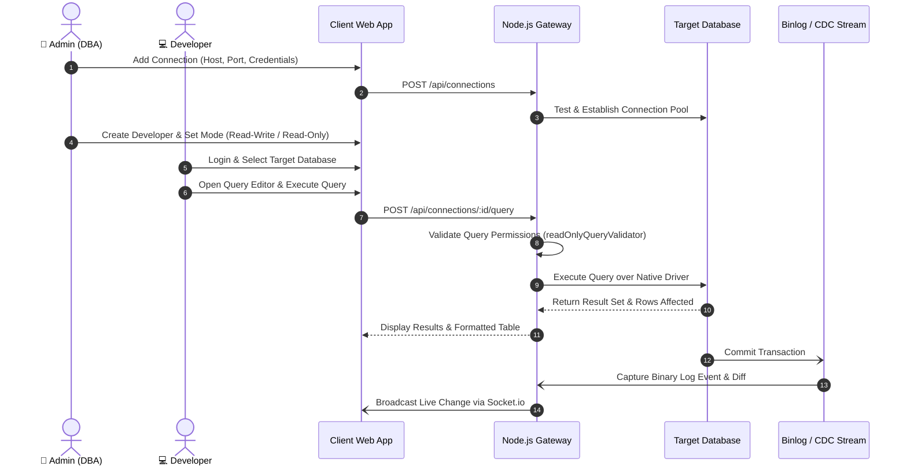

# DATABASE MANAGEMENT SYSTEM (DBMS Portal)
## Standard Operating Procedure (SOP) & Proof of Concept (POC)
### Application Flow, Technical Architecture & User Guide

**Version:** 1.0  
**Date:** April 2026  
**Classification:** Confidential  
**Supported Engines:** MySQL, PostgreSQL, MongoDB, Oracle Database  

---

## Table of Contents

- [1. Application Overview](#1-application-overview)
  - [1.1 Purpose](#11-purpose)
  - [1.2 Key Features](#12-key-features)
  - [1.3 Technology Stack](#13-technology-stack)
  - [1.4 User Roles](#14-user-roles)
- [2. System Architecture & Access Points](#2-system-architecture--access-points)
- [3. Admin Portal — Complete Flow](#3-admin-portal--complete-flow)
  - [3.1 Admin Login](#31-admin-login)
  - [3.2 Admin Dashboard](#32-admin-dashboard)
  - [3.3 Connection Management (Multi-Engine Provisioning)](#33-connection-management-multi-engine-provisioning)
  - [3.4 Database Objects & Schema Explorer](#34-database-objects--schema-explorer)
  - [3.5 Real-Time Binlog Audit & CDC (Change Data Capture)](#35-real-time-binlog-audit--cdc-change-data-capture)
  - [3.6 Live Health Monitoring & Telemetry](#36-live-health-monitoring--telemetry)
  - [3.7 Slow Query Profiler (>100ms Optimization)](#37-slow-query-profiler-100ms-optimization)
  - [3.8 Database Backup & Restoration Engine](#38-database-backup--restoration-engine)
  - [3.9 Compliance Audit Logs](#39-compliance-audit-logs)
  - [3.10 User & Role Management (RBAC)](#310-user--role-management-rbac)
- [4. Developer Portal — Complete Flow](#4-developer-portal--complete-flow)
  - [4.1 Developer Login & Session Management](#41-developer-login--session-management)
  - [4.2 Connection Selector & Database Context](#42-connection-selector--database-context)
  - [4.3 Developer Workspace Dashboard](#43-developer-workspace-dashboard)
  - [4.4 Intelligent Multi-Tab Query Editor](#44-intelligent-multi-tab-query-editor)
  - [4.5 Table Data Explorer & phpMyAdmin-Style Row Actions](#45-table-data-explorer--phpmyadmin-style-row-actions)
  - [4.6 Query History & Personal Script Library](#46-query-history--personal-script-library)
- [5. Notification & Alert Dispatch Flow](#5-notification--alert-dispatch-flow)
- [6. Complete Application Workflow (End-to-End)](#6-complete-application-workflow-end-to-end)
- [7. Security & Compliance Features](#7-security--compliance-features)
- [8. API Reference Summary](#8-api-reference-summary)
  - [8.1 Authentication Endpoints](#81-authentication-endpoints)
  - [8.2 Developer & Query Endpoints](#82-developer--query-endpoints)
  - [8.3 Admin & System Endpoints](#83-admin--system-endpoints)
- [9. Document Information](#9-document-information)
- [10. Multi-Engine Database Drivers & Integrations](#10-multi-engine-database-drivers--integrations)
- [11. API Rate Limiting Configuration](#11-api-rate-limiting-configuration)
- [12. Environment Configuration Reference](#12-environment-configuration-reference)

---

## 1. Application Overview

The **Database Management System (DBMS)** is a centralized, cloud-ready database administration, performance monitoring, and change-data-capture observability platform. It is engineered to unify polyglot database management across relational systems (**MySQL**, **PostgreSQL**, **Oracle Database**) and NoSQL document systems (**MongoDB**) into a single, high-performance web interface.

### 1.1 Purpose
Modern engineering teams frequently maintain multiple heterogeneous databases. Running separate desktop clients (such as *phpMyAdmin*, *pgAdmin*, *MongoDB Compass*, and *Oracle SQL Developer*) leads to tool fatigue, credential leakage, and operational overhead. 

DBMS is built to:
1. Provide a single interface for all database engines.
2. Serve as a secure gateway/proxy where developers query databases without possessing raw database passwords.
3. Deliver real-time auditability through live Binlog Change Data Capture (CDC).
4. Prevent data loss by enforcing strict Read-Only mode validation on restricted accounts.
5. Continuously detect performance bottlenecks via an automated slow query profiling engine.

### 1.2 Key Features
- **Multi-Engine Connectivity**: Native pools for MySQL, PostgreSQL, MongoDB, and Oracle Database.
- **Intelligent Multi-Tab Query Editor**: Auto-complete, syntax highlighting, keyboard shortcuts (`Ctrl+Enter`, `Ctrl+/`, `Ctrl+Z`), SQL beautifier, explain plans, and top-right copy icon.
- **Interactive Table Data Operations**: phpMyAdmin-style sticky row action buttons (`Copy Row`, `Edit Row`, `Insert Row`, `Delete Row`, `Open in Editor`) with live query generation previews and "Apply & Run in Query Editor" capability.
- **Real-Time CDC & Binlog Streamer**: WebSocket-powered live transaction feed with visual before-and-after row diffs and DML/DDL filters.
- **Performance Telemetry**: Recharts graphs tracking CPU, memory, active connections, and table disk space breakdown.
- **Automated Slow Query Profiler**: Captures queries >100ms with execution duration, row counts, and automated DBA tuning suggestions.
- **Database Backup & Restore**: Full logical database dumps with automated naming, download, and single-click restore.
- **Enterprise RBAC**: Role-based access control with developer Read-Write and Read-Only isolation.

### 1.3 Technology Stack

| Layer | Technology | Operational Function |
| :--- | :--- | :--- |
| **Frontend Framework** | **React 19 + Vite 8** | Modern Single Page Application with optimized modular bundling |
| **Styling & Theme** | **Tailwind CSS v3** | Responsive UI, dark/light contrast, modal dialogs, custom scrollbars |
| **Data Visualization** | **Recharts v3** | Interactive responsive line charts, bar graphs, and memory meters |
| **Client Routing** | **React Router v7** | Client-side routing with role-based access guards |
| **Client Network** | **Axios + Socket.io-client** | REST API calls with JWT Bearer interceptor; WebSocket duplex stream |
| **Backend Runtime** | **Node.js v24 + Express 5** | Non-blocking asynchronous REST API framework |
| **Real-Time WebSockets**| **Socket.io v4** | Event-driven gateway streaming Binlog CDC and system alerts |
| **Metadata Storage** | **MongoDB + Mongoose v9**| Persistent storage for users, connections, permissions, and audit logs |
| **RDBMS Connectors** | **mysql2, pg, oracledb** | High-throughput connection pools for MySQL, Postgres, and Oracle |
| **NoSQL Connector** | **mongodb Native Driver v7**| Direct driver executing native MQL aggregation and collection queries |
| **Security & Utilities** | **JWT, bcryptjs, helmet, express-rate-limit** | Stateless auth, password hashing, HTTP headers, rate limiting |

### 1.4 User Roles

```
                      ┌───────────────────────┐
                      │   Authenticated User  │
                      └──────────┬────────────┘
                                 │
                 ┌───────────────┴───────────────┐
                 ▼                               ▼
       ┌───────────────────┐           ┌───────────────────┐
       │   👑 Super Admin  │           │   💻 Developer    │
       └───────────────────┘           └─────────┬─────────┘
                                                 │
                                 ┌───────────────┴───────────────┐
                                 ▼                               ▼
                       ┌───────────────────┐           ┌───────────────────┐
                       │  ⚡ Read-Write    │           │  🔒 Read-Only     │
                       └───────────────────┘           └───────────────────┘
```

1. **👑 Super Admin (DBA)**: Complete system privileges—manages database connections, user accounts, connection sharing, access modes, global audit logs, health alerts, and backups.
2. **⚡ Developer (Read-Write Mode)**: Executes queries, runs DML (INSERT, UPDATE, DELETE), uses GUI table row actions, manages personal script libraries, and views live CDC.
3. **🔒 Developer (Read-Only Mode)**: Restricted exclusively to `SELECT` and `find()` queries. Strict query validator blocks any data mutation (`INSERT`, `UPDATE`, `DELETE`, `DROP`, `ALTER`) at the API and AST levels.

---

## 2. System Architecture & Access Points

| Portal / Access Point | Default URL / Port | Authentication Protocol | Access Scope |
| :--- | :--- | :--- | :--- |
| **Developer Workspace** | `http://<host>:5173/login` | JWT Bearer Token | Allowed connections, query editor, table data |
| **Admin Portal** | `http://<host>:5173/users` | Admin Role Guard + JWT | Connection setup, user provisioning, global audit |
| **REST API Gateway** | `http://<host>:5001/api` | Express 5 + Helmet | Controller routes, query runner, schema explorer |
| **WebSocket Stream** | `ws://<host>:5001/socket.io`| Socket.io Channel Auth | Real-time Binlog events, CDC diffs, server toasts |
| **Health Probe** | `http://<host>:5001/api/health`| Public HTTP GET | Liveness and readiness monitoring check |

---

## 3. Admin Portal — Complete Flow

### 3.1 Admin Login
- Split-screen design with secure credential authentication.
- Issues stateless JWT token stored securely in client storage.
- Auto-redirects to Admin Dashboard upon authentication.

### 3.2 Admin Dashboard
- Live count of total databases, registered connections, and active developers.
- Server health overview showing host memory and connection status.

### 3.3 Connection Management (Multi-Engine Provisioning)
- Add new connections for **MySQL**, **PostgreSQL**, **MongoDB**, and **Oracle**.
- Configure host, port, username, password, default database, and SSL options.
- Test Connection feature verifies network reachability and credentials before saving.
- Assign connections to specific developers with designated access modes (`readwrite` vs. `read`).

### 3.4 Database Objects & Schema Explorer
- Interactive tree and Workbench-style tabs: **Tables**, **Views**, **Stored Procedures**, **Functions**, **Indexes**, and **Constraints**.
- Inspect column definitions, primary keys, nullability, data types, and default values.
- Built-in syntax viewer for viewing Stored Procedure, Function, and Trigger DDL code.

### 3.5 Real-Time Binlog Audit & CDC (Change Data Capture)
- Connects directly to MySQL binary logs.
- Streams committed transactions live to connected clients over WebSockets.
- Visual Before-and-After row diff viewer highlights modified column values.
- Granular event filtering for DML (`INSERT`, `UPDATE`, `DELETE`), DDL (`CREATE`, `ALTER`, `DROP`), and Stored Procedures.

### 3.6 Live Health Monitoring & Telemetry
- Real-time Recharts graphs for CPU usage, memory utilization, and active connection pool load.
- Storage engine breakdown analyzing data size vs. index size per table.
- Background snapshot daemon recording periodic system health telemetry.

### 3.7 Slow Query Profiler (>100ms Optimization)
- Captures all queries exceeding the execution threshold (default >100ms).
- Records execution latency, client IP, timestamp, user identity, and affected rows.
- Automated tuning engine analyzes queries and provides actionable DBA optimization tips.

### 3.8 Database Backup & Restoration Engine
- Create on-demand or scheduled logical SQL backups.
- Generates downloadable `.sql` dump files with automatic timestamps.
- Integrated restore utility allows uploading and executing backup dumps.

### 3.9 Compliance Audit Logs
- Immutable audit trail recording user logins, queries executed, export operations, and schema alterations.
- Multi-parameter filtering by date range, user ID, connection, and action type with PDF/CSV export.

### 3.10 User & Role Management (RBAC)
- Create, edit, and deactivate user accounts.
- Assign roles (`admin` or `developer`) and default access mode (`readwrite` or `read`).
- Isolate users to specific database connections and schemas.

---

## 4. Developer Portal — Complete Flow

### 4.1 Developer Login & Session Management
- Authentication generates JWT credentials.
- Directs developer to authorized connections dashboard.

### 4.2 Connection Selector & Database Context
- Select from assigned database connections.
- Dynamically switch active database context via dropdown.

### 4.3 Developer Workspace Dashboard
- At-a-glance summary: active database, connection status, table count, and quick links.

### 4.4 Intelligent Multi-Tab Query Editor
- **Multi-Tab Sessions**: Work on multiple scripts with hybrid LocalStorage and MongoDB cloud sync.
- **Contextual Autocomplete**: Real-time suggestions for SQL keywords and database table/collection names.
- **Productivity Shortcuts**:
  - `Ctrl + Enter`: Execute current query or selected block.
  - `Ctrl + /`: Toggle line comments (`--` / `//`).
  - `Ctrl + Z`: Undo comment/edit modifications via native DOM undo stack preservation.
- **SQL Beautifier**: One-click formatting for unorganized queries.
- **Explain Execution Plan**: Analyzes query execution plan, displaying cost, rows scanned, and key indexes used.
- **Top-Right Copy Icon**: Instantly copy full query or highlighted selection with visual feedback.

### 4.5 Table Data Explorer & phpMyAdmin-Style Row Actions
- Interactive table records viewer with pagination, sorting, and search.
- **Sticky Row Actions Menu (`⚙️ Action`)**:
  - 📋 **Copy Row**: Copies full row data as JSON to clipboard.
  - ✏️ **Edit Row**: Modal form with editable fields and **Live Generated `UPDATE` Query Preview**.
  - ➕ **Insert Row**: Pre-filled or blank row insertion with **Live Generated `INSERT INTO` Query Preview**.
  - 🗑️ **Delete Row**: Confirmation modal with **Live Generated `DELETE` Query Preview**.
  - ⚡ **Open in Editor**: Loads row's `SELECT *` query into Query Editor.
- **⚡ Apply & Run in Query Editor**: Row action modals feature a button to transfer generated queries directly into the Query Editor tab and execute them live.
- **Optimistic UI Updates**: Deleting a row immediately removes it from the table viewport without latency.

### 4.6 Query History & Personal Script Library
- Automatic execution history tracking with execution time, status, and affected row counts.
- Save and organize reusable query scripts into personal libraries.

---

## 5. Notification & Alert Dispatch Flow

The platform supports automated alert dispatch across multiple communication channels:

| Trigger Event | Destination Channel | Payload Details | Action Taken |
| :--- | :--- | :--- | :--- |
| **Connection Down** | Email (SMTP) + Slack | Host, Port, Latency, Error | Alerts DBA to restore database connectivity |
| **High CPU/RAM (>90%)** | Discord / Slack Webhook | Host, Resource %, Timestamp | Triggers capacity inspection alert |
| **Slow Query Spike** | Email + Admin Dashboard | Duration (ms), Query, User | Captured in slow query registry with tuning tips |
| **Password Reset** | Email (Nodemailer) | Secure Token + Reset Link | Allows single-use password reset |
| **Schema Change (DDL)** | Socket.io + Audit Trail | ALTER/DROP Statement, User | Broadcasts live to active sessions |

---

## 6. Complete Application Workflow (End-to-End)



---

## 7. Security & Compliance Features

- **JWT Authentication**: Secure tokens with expiration and header verification.
- **Read-Only AST Query Validator**: Intercepts queries from read-only users and blocks mutation keywords (`INSERT`, `UPDATE`, `DELETE`, `DROP`, `ALTER`, `TRUNCATE`) with HTTP 403.
- **SQL & XSS Sanitization**: Input sanitization strips malicious command injections before execution.
- **HTTP Security Headers**: Powered by `helmet` to mitigate XSS, Clickjacking, and MIME sniffing.
- **API Rate Limiting**: Powered by `express-rate-limit` to prevent brute-force attacks and query flooding.
- **Bcrypt Password Encryption**: Industry-standard salt rounds (10–12) for all stored user credentials.
- **Encrypted Credential Isolation**: Database connection passwords remain server-side and are never sent to the client.
- **Immutable Audit Trail**: All authentication events, queries, exports, and schema changes are permanently logged.

---

## 8. API Reference Summary

### 8.1 Authentication Endpoints
- `POST /api/auth/login` — User authentication; returns JWT token and role metadata.
- `POST /api/auth/forgot-password` — Requests password reset email with secure token.
- `POST /api/auth/reset-password` — Validates token and updates user password.

### 8.2 Developer & Query Endpoints
- `GET /api/connections` — Lists all database connections accessible to the authenticated user.
- `POST /api/connections/:id/query` — Executes SQL/MQL queries with AST safety validation.
- `GET /api/connections/:id/objects` — Fetches database tables, views, procedures, and indexes.
- `GET /api/connections/:id/table/:tableName` — Retrieves table records with column definitions and pagination.
- `GET /api/history` — Retrieves personal query execution history.
- `GET /api/saved-queries` — Lists saved scripts from personal library.
- `POST /api/saved-queries` — Saves a new SQL/MQL script to library.

### 8.3 Admin & System Endpoints
- `POST /api/connections` — Creates a new database connection instance.
- `PUT /api/connections/:id` — Updates connection parameters or access permissions.
- `DELETE /api/connections/:id` — Deletes a database connection instance.
- `GET /api/connections/:id/binlog` — Retrieves historical and live Binlog CDC transactions.
- `GET /api/connections/:id/stats` — Fetches real-time server health and telemetry metrics.
- `GET /api/slow-queries` — Fetches captured slow queries with automated tuning advice.
- `GET /api/users` — Lists all registered platform users (Admin only).
- `POST /api/users` — Creates new developer user with assigned permissions (Admin only).
- `PUT /api/users/:id` — Modifies user role, access mode, or connection access (Admin only).

---

## 9. Document Information

- **Document Title**: DBMS — Database Management System — SOP & POC Application Flow
- **Document Version**: Version 1.0 (Production Release)
- **Release Date**: April 2026
- **Classification**: Confidential — Internal & Authorized Stakeholders Only
- **Prepared By**: DBMS Engineering & DBA Architecture Team
- **Reviewed By**: Technical Lead & Product Management

---

## 10. Multi-Engine Database Drivers & Integrations

The platform features dedicated, high-performance driver implementations for each supported database engine:

### 10.1 MySQL Integration
- **Driver**: `mysql2` connection pooling.
- **Features**: Connection pooling, binary log replication stream, InnoDB schema discovery, explain format=JSON, transaction support.

### 10.2 PostgreSQL Integration
- **Driver**: `pg` (node-postgres).
- **Features**: Search path schemas, JSONB columns, `EXPLAIN ANALYZE` execution cost, `pg_stat_activity` monitoring.

### 10.3 MongoDB Integration
- **Driver**: `mongodb` native driver v7.
- **Features**: MQL shell command execution, `find`/`aggregate` pipelines, collections inspector, WiredTiger cache metrics.

### 10.4 Oracle Database Integration
- **Driver**: `oracledb` Thin Client.
- **Features**: `USER_OBJECTS` metadata queries, user constraints, `ROWNUM` / `FETCH FIRST` pagination, auto-commit handling.

---

## 11. API Rate Limiting Configuration

To support concurrent multi-developer usage while protecting backend infrastructure from abusive requests, the platform applies rate limits via `express-rate-limit`:

| Rate Limiter Policy | Time Window | Max Requests Allowed | Applies To |
| :--- | :--- | :--- | :--- |
| **Global API Routes** | 15 Minutes | 100,000 / IP | All API routes (excluding `/health`) |
| **Authentication** | 15 Minutes | 100 / IP | `/api/auth/login`, `/api/auth/reset-password` |
| **Query Execution** | 15 Minutes | 5,000 / IP | `/api/connections/:id/query` |
| **Database Backups** | 1 Hour | 50 / IP | Backup export and dump download endpoints |
| **Admin Management** | 15 Minutes | 10,000 / IP | Admin-only configuration routes |

---

## 12. Environment Configuration Reference

The following environment variables configure the application runtime:

```bash
# Server Networking
PORT=5001
NODE_ENV=production

# App Metadata Database
MONGO_URI=mongodb://127.0.0.1:27017/dbmanager

# Security & Tokens
JWT_SECRET=super_secret_jwt_key_dbms_enterprise_2026
JWT_EXPIRES_IN=24h

# Client Origins (CORS)
FRONTEND_URL=http://localhost:5173

# Email Notifications (SMTP)
SMTP_HOST=smtp.mailtrap.io
SMTP_PORT=2525
SMTP_USER=your_smtp_user
SMTP_PASS=your_smtp_password
EMAIL_FROM=noreply@dbmanager.io

# External Alert Webhooks
SLACK_WEBHOOK_URL=https://hooks.slack.com/services/...
DISCORD_WEBHOOK_URL=https://discord.com/api/webhooks/...
```
